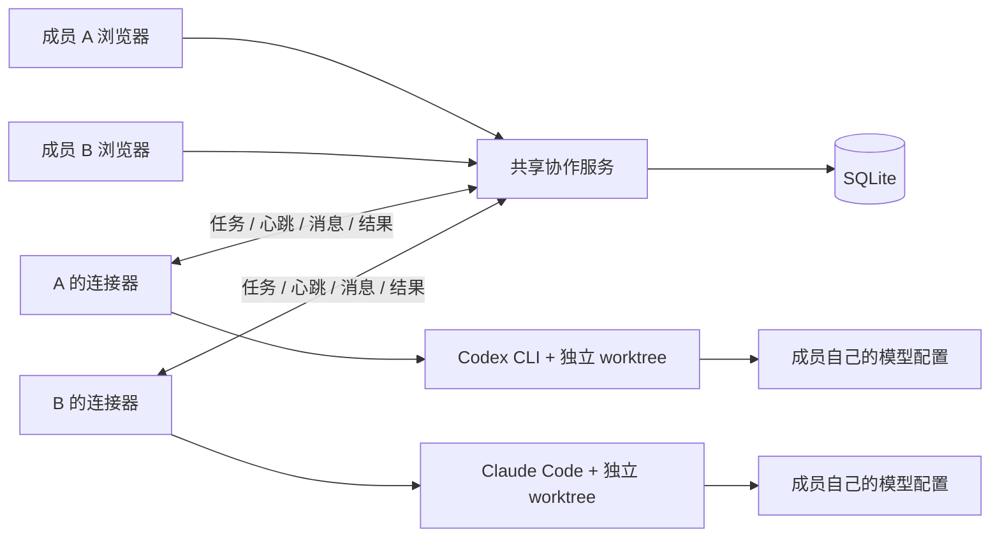
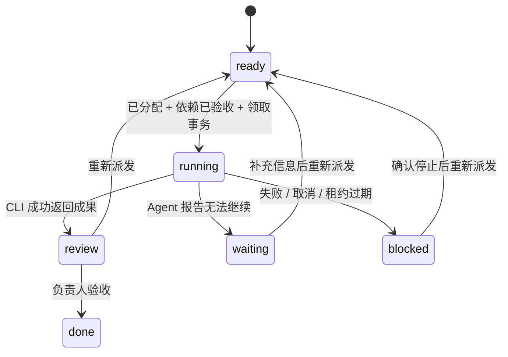

# 架构

Agent Collab 将团队协作状态放在一个服务中，把代码执行留在成员电脑上。它不转发模型请求。

## 文件分工

| 位置 | 职责 |
| --- | --- |
| `src/server.mjs` | HTTP、身份路由、JSON 与来源校验、静态页面 |
| `src/store.mjs` | 数据、角色权限、任务状态、领取事务、租约 |
| `bin/connector.mjs` | 本机确认、Git worktree、CLI 启停、心跳、成果回传 |
| `bin/collab.mjs` | Agent 读取快照和写消息发件箱 |
| `public/` | 原生 HTML / CSS / JS，2 秒轮询 |

服务端使用 Node 24 内置 SQLite，不需要 Redis、消息队列或模型 SDK。第一版优化的是能被团队快速运行、理解和修改，而不是大规模吞吐。

## 身份与信任边界

- 成员 token：只读写本空间；负责人可以邀请、分配和验收。普通成员可创建任务、认领未分配任务到自己的 Agent、发消息。
- 连接器 token：绑定单个成员的单个 Agent，可领取分给自己的任务并管理执行。不能读取成员身份接口。
- 执行 token：只用于当前活跃轮次的上下文与消息，取消/失联/结束后失效。
- Agent 子进程不直接接收连接器 token，而是读写文件邮箱。这减少凭证进入模型上下文的机会；并非对恶意本机进程的强安全隔离。
- 空间内所有人共享项目内容。模型产出的消息只作为讨论，不自动升级为项目决定。
- HTTP JSON 64 KB 上限；文本字段有限长；动态 UI 文本转义；CSP 不允许内联脚本；默认仅监听本机。

## 状态与并发

`runs` 保留每一轮的状态、结果与工作目录，`tasks.current_run` 指向当前轮次。旧轮次不能续租或覆盖新轮次结果。每个 Agent 同时至多一轮 running/lost；领取用 `BEGIN IMMEDIATE` 与条件校验串行化。

失联表示“不知道成员机器上发生了什么”，不等于执行已经停止。当前采用保守阻塞与人工确认，没有声称分布式执行 exactly-once；网络分区与机器崩溃仍需人介入。

邮箱消息使用 `(run_id,message_id)` 唯一键去重；请求响应丢失后重发不重复写入。成果回传对同一终结轮次幂等。运行状态通过心跳/轮询触发过期检查，不依赖服务端后台定时器。

## 已知限制与下一步

1. **代码交接**：没有远程成果同步和 PR 集成。依赖完成不等于下游电脑已拿到代码。
2. **协作行为**：当前 Agent 通过提示词和 CLI 工具读写团队信息，不会实时订阅并自主持续协商。
3. **执行恢复**：重试是新轮次、新 worktree，不是恢复旧模型会话。上一轮结果与路径可以查阅。
4. **部署**：单实例 SQLite，需 HTTPS 反向代理；没有 OAuth、多实例调度、token 撤销与配额管理。
5. **平台**：本轮测试在 macOS 完成。Unix 使用进程组清理；Windows 进程树行为尚未验证。
6. **协议扩展**：目前内置两种真实适配。下一阶段适合抽离 adapter 接口，再实现成果 Git 同步和集成验证。

优先验证两个人是否少了人工传话、是否减少冲突与返工。可记录从分配到验收的时长、提问次数、阻塞时长与集成失败次数，再决定是否增加自动拆解和调度。
